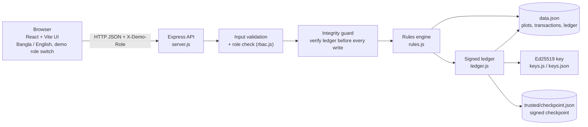

# 🔒 LandLock — One Land. One Owner.

**Bangladesh LandTech Hackathon · Track: Digital Land Records, Verification & Digitization**
**Problem statement: P3 — Catch Fraud & Double-Selling**

LandLock is a working prototype that locks a plot the moment a sale starts, blocks a second sale or mortgage on the same land, flags gaps between deed registration and mutation (namjari), and keeps a tamper-evident, digitally signed history of every land event. Every decision is explained in plain Bangla and English.

> **Prototype with synthetic data only.** All plots, owners, khatian/dag numbers, loans and survey records are invented. LandLock is not connected to any government system and does not provide legal verification of ownership.

---

## 1. The problem

In Bangladesh, a land sale passes through two separate offices: the deed is registered at the **Sub-Registry office**, and the record of rights (khatian) is updated later through **mutation (namjari)** at the **AC Land office**. Between those steps, and across old survey records (CS → SA → RS → BS), fraud can slip in:

- the same plot is sold to **two buyers** while the first sale is still in progress;
- someone who is **not the recorded owner** sells the land;
- a plot that is **mortgaged to a bank** is sold or mortgaged again;
- a deed is registered but the **mutation never happens**, so the old owner still appears as owner and can sell again;
- historical records are **quietly edited**.

LandLock shows how a shared, plot-level lock plus a verifiable history can stop these cases at the moment a transaction is attempted.

## 2. Key features and fraud scenarios

| Fraud scenario | What LandLock does |
|---|---|
| Double-selling | Starting a sale puts the plot in **Pending (locked)**; any second sale or mortgage is blocked (`PLOT_LOCKED`). Tested with 20 simultaneous requests: exactly one wins. |
| Seller is not the owner | Seller must match the recorded owner (`NOT_OWNER`); after a transfer the old owner cannot sell again. |
| Cancel-and-resell after registration | A **registered deed cannot be cancelled**. Only the AC Land Officer can complete the mutation or **reject** it, which marks the plot **Disputed** (Red, still locked). |
| Registered but not mutated | Flagged Yellow and listed on a "Registered but not mutated" dashboard. |
| **Deed and khatian disagree** (registration–mutation mismatch) | Each plot's latest **Sub-Registry deed** is compared with the **khatian** (AC Land record) side by side. If the deed names a different buyer than the khatian owner (deed registered, mutation never done), the plot is **Red and sales/mortgages are blocked**: the old owner cannot sell again. A different area is a Yellow warning. Every message says it is a mismatch, not proof of fraud. The AC Land Officer can complete the missing mutation (`reconcile`), which is recorded as a signed ledger event. |
| Selling more (or less) land than recorded | Larger area blocked (`AREA_EXCEEDS`); partial sales rejected (`PARTIAL_SALE_NOT_SUPPORTED`) because plot subdivision is not built yet. |
| Mortgaged land | Sale of a mortgaged plot, double mortgage, mortgage during a sale and mortgage by a non-owner are blocked; release needs the matching loan number. |
| Reused deed numbers, self-sales | `DUPLICATE_DEED`, `SAME_PARTY`. |
| Suspicious survey history | Owner changes without a deed/inheritance record, or area increases, between CS / SA / RS / BS are flagged Yellow (a warning, not proof of fraud). |
| Edited history | Hash chain + Ed25519 signatures + signed checkpoint + full replay detect edited, forged, deleted, reordered or truncated entries and direct owner edits. While the check fails, **all writes are refused**. |

Also included:
- **Explainable risk result:** Green / Yellow / Red, with every reason in Bangla and English. Green means **"No warnings found"**, never "safe". An accepted sale lists each check that passed and what is *not* checked.
- **Demo role switch:** Buyer (read-only), Sub-Registrar and AC Land Officer, with permissions enforced by the API, not just hidden buttons.
- **Strict server-side validation:** malformed values never reach storage or the signed ledger.

## 3. Architecture



| Layer | Technology |
|---|---|
| Frontend | React 19, Vite 8 (single page, inline styles, Bangla/English) |
| Backend | Node.js (20.12+), Express 4, cors |
| Storage | JSON files with atomic writes (no database server needed) |
| Cryptography | Node's built-in `crypto`: SHA-256 hash chain, Ed25519 signatures |
| Tests | Plain Node test script (no extra framework) |

```
LandLock/
├── README.md                ← this file
├── backend/                 ← Node.js + Express API
│   ├── src/                 ← server.js, rules.js, ledger.js, keys.js, db.js, rbac.js, config.js, fsutil.js
│   ├── test/test.js         ← automated tests
│   ├── data/                ← created on first start, git-ignored: data.json, keys.json, trusted/
│   ├── .env.example         ← settings template (placeholders only)
│   ├── package.json
│   └── README.md            ← API and technical reference
└── frontend/                ← React + Vite UI
    ├── src/                 ← App.jsx, PlotMap.jsx (mouza map), Logo.jsx, index.css
    ├── public/              ← favicon
    ├── .env.example
    ├── package.json
    └── README.md
```

## 4. Setup (Windows)

**Prerequisites:** [Node.js](https://nodejs.org) **20.12 or newer** (LTS recommended; tested with 24.16), which includes npm. Git is optional.

Open **PowerShell** in the project folder.

**Terminal 1: backend**
```powershell
cd backend
npm install
npm run demo        # API on http://localhost:4000 with demo tools enabled
```
Use `npm start` instead to run **without** the demo tools (the safe default).

**Terminal 2: frontend**
```powershell
cd frontend
npm install
npm run dev         # open http://localhost:5173
```

| Service | Address |
|---|---|
| Backend API | http://localhost:4000/api |
| Frontend | http://localhost:5173 |
| Test servers (`npm test`) | ports 4100 and 4101, temporary |

There is no proxy: the UI calls the API directly. To point the UI at another address, set `VITE_API_URL` (see below).

On the very first start the backend creates `backend/data/` with `data.json` (from the sample data), a signing key (`keys.json`) and the ledger checkpoint (`trusted/`). The whole `data/` folder is git-ignored. **Back it up as one unit**: the key must stay with the data it signed.

## 5. Configuration

Both parts work without any configuration. To change settings, copy the examples (they contain placeholders only):

```powershell
Copy-Item backend\.env.example backend\.env
Copy-Item frontend\.env.example frontend\.env
```

| Variable (backend `.env`) | Default | Purpose |
|---|---|---|
| `PORT` | 4000 | API port |
| `NODE_ENV` | unset | `production` disables demo tools and automatic key generation |
| `LANDLOCK_DEMO_MODE` | off | exactly `true` enables the demo endpoints |
| `LANDLOCK_DATA_DIR`, `LANDLOCK_TRUST_DIR`, `LANDLOCK_KEY_FILE` | `backend/data/` | where data, checkpoint and key live |
| `LANDLOCK_REQUIRE_KEY` | off | `true` = never auto-generate a signing key |
| `LANDLOCK_EXTRA_GRANTS` | empty | extra role permissions (server-side only) |

| Variable (frontend `.env`) | Default | Purpose |
|---|---|---|
| `VITE_API_URL` | `http://localhost:4000/api` | backend address |

`.env`, `.env.*` (except `.env.example`), `backend/data/` (data, key, checkpoint), `keys.json`, `*.pem`, `*.key`, lock and temp files are all git-ignored.

## 6. Running the tests

```powershell
cd backend
npm test
```
The suite starts its **own** servers on ports 4100/4101 with temporary data, key and checkpoint files and deletes them afterwards, so your `data.json` and `keys.json` are never touched and the main server can keep running. It covers the full sale/mortgage/survey story, roles, input validation, disputes, full-plot rule, wording, concurrency, ledger tampering, restarts, demo-mode guard, signing-key handling and failed-write rollback. The last line says `All tests passed` or how many failed. One `INFO` line documents a known limitation (see §10).

Frontend checks:
```powershell
cd frontend
npm run lint
npm run build
```

## 7. Demo tools (local only)

The reset and attack-simulation endpoints (`/api/dev/reset`, `/api/dev/tamper`, `/api/dev/tamper-smart`, `/api/dev/attack`) let you show tampering being caught. They are **off by default** and enabled only by an explicit choice:

```powershell
npm run demo                       # or: $env:LANDLOCK_DEMO_MODE="true"; npm start
```

They can **never** be enabled when `NODE_ENV=production`. When disabled they return `404 DEMO_DISABLED` and the UI hides the demo buttons. Check it yourself:

```powershell
# backend started with: npm start
curl.exe http://localhost:4000/api/config                 # {"demo_mode":false}
curl.exe -i -X POST http://localhost:4000/api/dev/reset   # HTTP/1.1 404 ... DEMO_DISABLED

# production: demo stays off even if requested (needs an existing keys.json)
$env:NODE_ENV="production"; $env:LANDLOCK_DEMO_MODE="true"; npm start
# log: "Demo mode was requested but NODE_ENV=production: demo endpoints stay disabled."
Remove-Item Env:NODE_ENV; Remove-Item Env:LANDLOCK_DEMO_MODE
```

### Suggested 3-minute demo
1. **Sub-Registrar:** on P1 start a sale Rahim → Karim (10). The plot locks; the green box lists every check that passed.
2. Try a second sale on P1 → **blocked: a sale is already in progress**.
3. **Mark deed registered**: Cancel disappears; the plot shows Yellow "registered but not mutated".
4. **AC Land Officer:** complete the mutation → Karim owns P1, plot unlocked. (Or reject it with a reason → **Disputed**, Red.)
5. Click **Change P1 owner directly (demo)** → the banner turns red ("records do not match the ledger") and any new sale is refused. **Reset (demo)** restores everything.
6. Switch to **Buyer**: everything is read-only; with "Enable blocked buttons" the server answers ⛔ Permission denied.
7. **Deed vs khatian (P6):** the deed 1450/2019 says Monir sold to Shapla, but the khatian still shows Monir → Red. As Sub-Registrar try selling P6 as Monir → **blocked**. As **AC Land Officer** click *Complete mutation for deed 1450/2019* → owner Shapla, Green, records agree. **P7** shows an area mismatch (deed 14 vs khatian 18 decimal) as a Yellow warning.

## 8. Sample data

Seven synthetic plots, **P1–P7**, in mouzas named Rampura, Banasree, Uttara, Mirpur and Savar, with invented owners, khatian/dag numbers, survey history (CS 1924 → SA 1960 → RS 1985 → BS 2012) and one sample bank mortgage (P4). **P6 and P7** also carry a sample "latest Sub-Registry deed" record with deliberate mismatches against the khatian (P6: owner, P7: area). The place and bank names are used only to look familiar; the records themselves are fictitious and contain **no real person's data**. The data is defined in `seed()` in `landlock-backend/landlock-backend/db.js`, and the UI labels it "DEMO / SAMPLE DATA".

## 9. Cryptographic integrity workflow

1. Every event (sale started / blocked / registered / mutated / rejected / cancelled, mortgage created / blocked / released) is appended to the ledger.
2. Each entry stores `hash = SHA-256(previous hash + event)`, so changing any past entry breaks every link after it.
3. The hash is **signed with Ed25519** (`keys.json`). Someone who edits an entry and recomputes all hashes still cannot produce valid signatures without the private key.
4. Entry #1 is a signed **GENESIS** entry that must equal the starting register; entry ids must run 1, 2, 3…
5. A signed **checkpoint** (number of entries + latest hash) is kept in server memory and in `trusted/checkpoint.json`, so deleting the newest entries is detected.
6. The verifier **replays** all events and compares the result with the current plots and transactions, so an owner or mortgage changed directly in the file is detected.
7. `GET /api/ledger/verify` runs all of this; before every write the server runs it too and refuses to write (423) if it fails.

**What this does not do:** hashes and signatures make tampering *detectable*; they do not prevent it, and they say nothing about whether the original data was true. Anyone with the private key can forge everything. Restoring an old copy of *both* `data.json` and the checkpoint together is not detectable locally; that needs an external witness. A hash chain is not a legally immutable record.

## 10. Data persistence, keys and limitations

**Persistence:** JSON files written atomically (temp file, flush, rename) with retries for OneDrive/antivirus locks. A failed write request is rolled back. A corrupted `data.json` stops the server and is never overwritten. One server per data folder (lock file). Data survives restarts.

**Signing key:** generated once for a brand-new database, never overwritten, never in production. The server refuses to start if the key is missing while signed data exists, or if it is unreadable, not Ed25519, or a mismatched pair, rather than silently signing with a new key. The private key is never sent to the browser, returned by the API, written to logs, or committed to Git. **Back up `keys.json` together with `data.json`.**

**Known limitations (prototype):**
- The role switch is **not authentication**: any client can claim any role. Production needs real login, secure sessions and identity-based authorization.
- Seller identity is matched **by name only**, with no NID or biometric check; legal title is not verified.
- JSON storage and a single Node process: not suitable for many users or several servers.
- Private key in a plain file: production needs an HSM or managed key service.
- CORS is open; there is no HTTPS or rate limiting.
- Not built yet: plot subdivision, automatic expiry of abandoned pending sales, a dispute-resolution workflow, importing real Sub-Registry deed records (P6/P7 use sample deed records), and integration with real government systems.

## 11. AI tools used

> **Team: please review and edit this section so it accurately describes your own use of AI tools before submitting.**

| Tool | How it was used |
|---|---|
| Claude Code (Anthropic) | Used in this repository for code review and audit, implementing validation, role checks, ledger-integrity checks, safe storage and key handling, writing automated tests, and drafting documentation. Changes were made step by step with test runs. |
| *(add other tools, if any)* | *(describe)* |

## 12. Troubleshooting

| Problem | Fix |
|---|---|
| UI says "Cannot connect to the backend" | Start the backend first (`npm start` / `npm run demo`) and check http://localhost:4000/api/plots. If you changed the port, set `VITE_API_URL` and restart `npm run dev`. |
| `npm` "cannot be loaded because running scripts is disabled" | Run `Set-ExecutionPolicy -Scope CurrentUser RemoteSigned` once, or use `npm.cmd` instead of `npm`. |
| `process.loadEnvFile is not a function` | Node.js is too old; install 20.12 or newer (`node --version`). |
| `EADDRINUSE: address already in use :::4000` | Another program uses port 4000. Find it with `Get-NetTCPConnection -LocalPort 4000` and stop it, or set `PORT` in `.env`. |
| "another LandLock server (PID …) is already using this data folder" | Stop the other backend window. If none is running, delete `backend\data\data.json.lock`. |
| "signing key file keys.json is missing, but signed ledger data already exists" | Restore your original `backend\data\keys.json`. To start completely fresh instead, move the whole `backend\data` folder somewhere else and start again. |
| "data.json is not valid JSON" | Restore it from a backup, or move it aside to start again from the sample data. |
| Red banner "Ledger check failed" / writes return 423 | Expected after using a demo attack. Click **Reset (demo)** (demo mode), or stop the server and move the `backend\data` folder aside. |
| Demo buttons are missing | The backend is running without demo mode; restart it with `npm run demo`. |
| A button is greyed out / "Permission denied" | Choose the right role in the DEMO ROLE SWITCH (e.g. AC Land Officer for mutation). |
| Port 4100 busy when running tests | Stop whatever uses it, or run `$env:TEST_PORT=4200; npm test`. |
